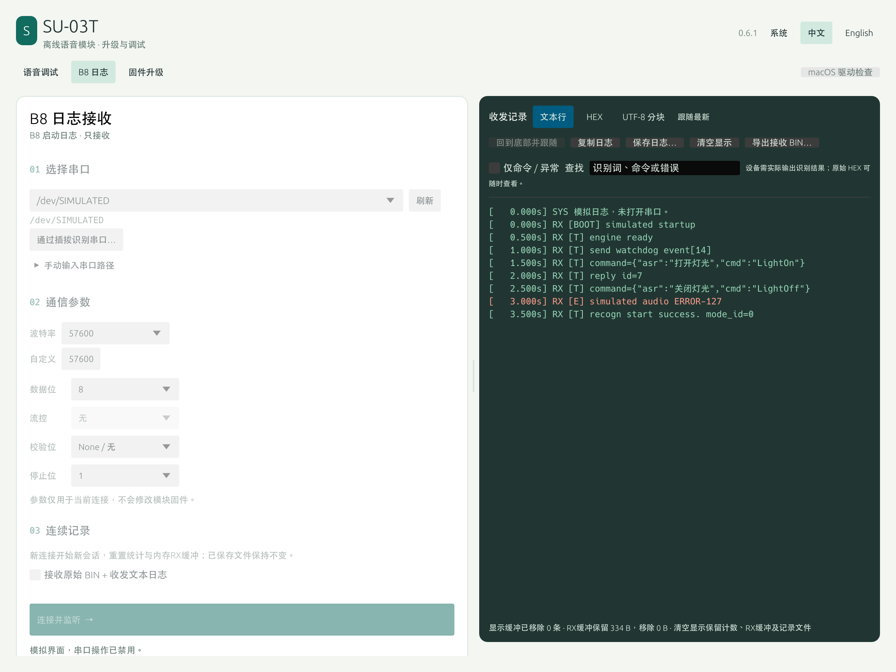
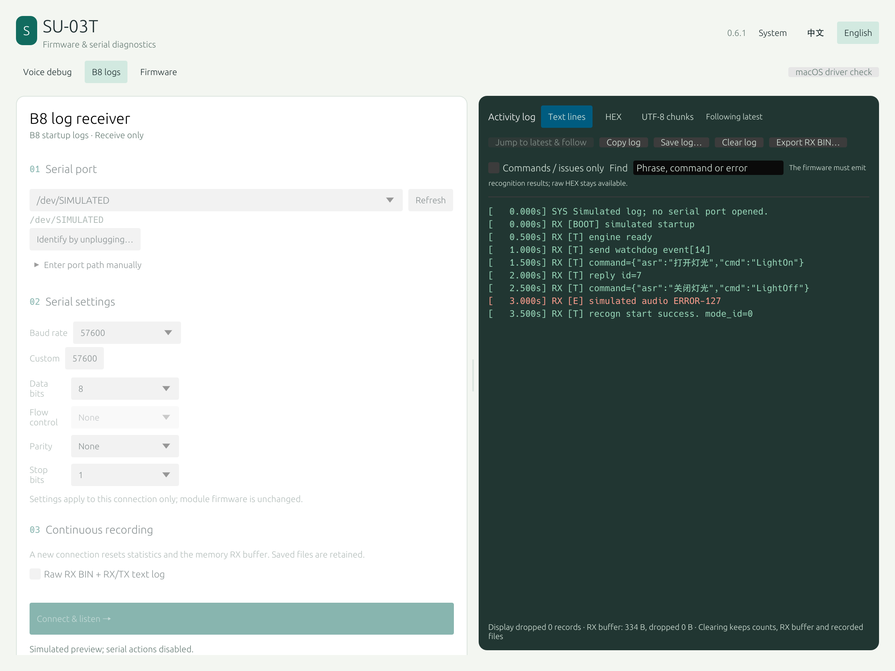

# Readable serial logs

**B8 logs** defaults to **Text lines**. It joins RX bytes across serial reads into CRLF/LF/CR-delimited lines, preserves split UTF-8 characters and removes terminal CSI/OSC color/control sequences for display without executing them. A pending line updates in place before its newline arrives. Invalid bytes remain visible as `\xNN` once complete or the session ends. Oversized lines use bounded continuation rows marked `↩`.

The **HEX** and **UTF-8 chunks** views retain the original chunk-oriented presentation. Original device text is not translated. Only system notices follow the UI language. Text lines can also be selected for other serial presets; binary data is not thereby interpreted as recognized speech.

## Find commands and issues

Use **Commands / issues only** to focus on command/recognition-related keywords and error/warning markers. The checkbox is off by default. **Find** performs a case-insensitive text search. These are presentation filters, not a protocol decoder; firmware must actually emit recognition results for spoken words or command IDs to appear. Raw input is not used to invent missing recognition results. Highlighted messages are textual issue candidates, not an independent device-health diagnosis. The error counter reports serial-task errors, not the number of device `[E]` messages.

Copy/save in Text lines mode exports the current matching text-line cache with timestamps and directions, without per-read HEX prefixes or color escapes. Chunk modes retain their previous export format. **Export RX BIN** and continuous `.rx.bin` recording preserve exact original bytes, including terminal codes, newlines and bytes hidden by display filters. Continuous `.log` recording remains a transport-chunk record. Display clearing preserves RX/TX counters, raw RX, command counters and recording files; it clears text/chunk histories and the pending text-line fragment so cleared text cannot reappear on the next read.

Text history is independent of chunk history: many one-byte reads no longer evict whole command lines after only 2,000 reads. Each cache is bounded to 2,000 records and roughly 1 MiB of retained data/metadata; the text parser also bounds pending line/escape storage (about 8 KiB/512 bytes). History reading pauses following. New input does not jump the reader to the bottom, including during language changes. Visible-row eviction adjusts the paused position; **Jump to latest & follow** uses a bounded finite offset.

## Screenshots

These native previews use simulated two-byte reads, generic command phrases and a synthetic error. Physical controls are disabled; no serial device is opened and no private device log is included.

Chinese text-line view:



English text-line view (original device phrases remain untranslated):



## Startup coverage

The mode name **B8 startup logs** does not prove the capture contains startup. Tool-relative timestamps measure the host connection, not module uptime. An export saying earlier display records were removed contains only its retained window. Missing earlier rows cannot be reconstructed from that text export.

To capture startup, explicitly connect B8 before manually powering/restarting the chosen module. Enable continuous recording before connection when the complete byte stream is needed; the existing per-stream four-file/16 MiB rotation still applies. The in-memory raw RX export can preserve data that has already left the display cache, within its own stated limit. Neither B8 connection nor this formatting feature sends reset/bootloader triggers or automatically changes module power. Receive-only and no-flow-control checks remain enforced by the serial core.

## Implementation and checks

[Bounded text presentation](../../src/console_text.rs) is device-free and separate from [serial transport](../../src/serial_debug.rs) and [raw capture](../../src/capture.rs). [The native console](../../src/debug_ui.rs) maintains both line/chunk caches, selected-view exports, filters, counters and scroll state. Debug/test preview suppresses discovery and uses synthetic input; no attached serial device is opened.

Synthetic tests exercise one-byte UTF-8/ANSI splits, CRLF/CR/LF, OSC and malformed escapes, incomplete/invalid tails, bounded long lines/history, retained original bytes after chunk eviction, search/issue filtering, clear behavior and actual egui history/follow/language transitions. Existing client/event PTY acceptance checks remain relevant to receive-only and exact-byte preservation. Native screenshots use the `b8-lines` scene only, with simulated generic commands/errors and disabled physical actions:

```sh
cargo test --locked
cargo test --locked --no-default-features
cargo clippy --locked --all-targets -- -D warnings
cargo build --locked
python3 tests/client_acceptance.py target/debug/su03t-update
python3 tests/transfer_events.py target/debug/su03t-update
python3 scripts/capture-ui.py --skip-build --scene b8-lines \
  --output .harness/local-evidence/console-ui
```

Always rebuild default features before native capture after CLI-only tests; variants share the debug executable path. Formatting tests and file reassembly do not establish firmware health, recognition accuracy, audio correctness or complete startup coverage.
