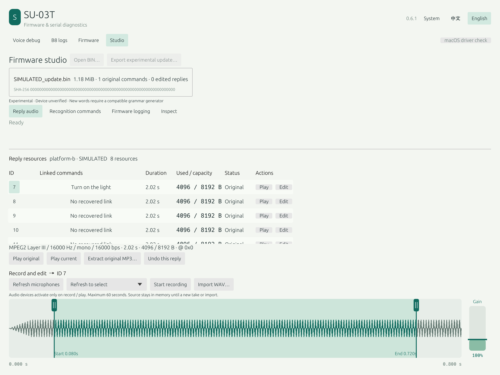
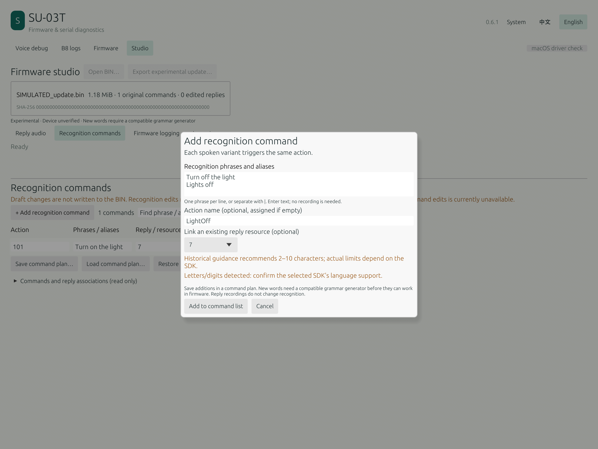

# Firmware studio

The desktop **Studio / 固件制作** tab imports an existing full or update BIN, inspects recovered command/reply associations and engine configuration, previews/extracts original replies, and replaces a selected reply with an in-application recording or imported WAV. Exports are experimental and have not been accepted on a device. Recording changes spoken output; it does not change recognized words or control logic. The [firmware runtime logging switch](logging.md) edits a separately authenticated configuration byte and can be exported together with audio changes.

## Workspace layout

The workbench has four panes: **Reply audio**, **Recognition commands**, **Firmware logging** and **Inspect**. File identity and the experimental-update export action stay above the scrollable editor. Each pane retains its scroll position, selected reply and full source recording across navigation. The fixed status area preserves the viewport during playback/recording. Export hover text explains the generated BIN/manifest and why export may be disabled.



[Chinese workbench](images/studio-zh.png). Screenshots are native synthetic previews; no serial, microphone or speaker device was opened.

## First edit

1. Open the desktop build and select **Studio**. Open or drop a BIN. The original file is read once into memory and is never overwritten. Changing images with retained recordings/edits requires an explicit discard action; a failed import leaves the previous session intact.
2. Open **Reply audio** to browse reply resources. **Recognition commands → Commands and reply associations** shows recovered commands and reply IDs. The resource table shows ID, linked phrases, duration, used/capacity bytes, original/modified status and Play/Edit actions. **Edit** decodes the current reply into the waveform without playback; its retained source replaces the previous source. Click an available reply ID in the command table or select a row in the reply resource table. The **Inspect** configuration tree is read only. Hover a command's source offset to see whether a consecutive pointer array corroborates it. GPIO/UART action encodings are not recovered.
3. Click **Play original** or **Extract original MP3**. Playback uses FFmpeg for decoding and the system's default output. **Play current** previews the edited version. No device enumeration, permission request, capture or playback occurs merely from importing a BIN.
4. Click **Refresh microphones**, select the input, then **Start recording**. Grant the OS permission when prompted. **Stop and keep** retains the full mono source in memory. Capture stops at 60 seconds; **Discard take** keeps the previous source. Input errors are shown without discarding the previous source. Alternatively import a PCM/float WAV up to 60 seconds, 8–192 kHz, one to eight channels (mixed to mono).
5. Drag the waveform start/end handles to trim, drag inside the selection to move it, or Shift-drag (in either direction) to select a new interval. Dragging outside the selection also starts a new interval. Gestures snap to samples and retain at least one sample. Drag the right vertical gain fader (0–4×); the waveform reflects amplitude changes and highlights clipping in the selected interval. Numeric start/end and the gain slider remain available. Preview the edited audio, or save the trimmed WAV. Reset returns to the retained full source. A clipping warning indicates excessive gain. A new successful take/import replaces the retained source; save it before closing the app.
6. Click **Convert and replace selected reply**. Local FFmpeg with libmp3lame must be installed; select its executable in converter settings if automatic lookup fails. Conversion runs on a cancellable worker. The fixed output is raw MPEG2 Layer III, 16 kHz mono, 16 kbps, without ID3/Xing. If the aligned output exceeds the selected slot, trim/re-record; the old reply remains intact. Replacing one ID affects all commands referencing that ID. **Undo this reply** restores the image-import snapshot for that resource.
7. The header action **Export experimental update** writes a new BIN plus an adjacent `BIN.manifest.json`. Both paths must be new. The manifest records source/edited/output SHA-256, changed reply IDs and exact changed byte ranges. If the sidecar cannot be created, the new BIN is removed. No flashing starts. Reopen the exported BIN to inspect or edit it again.

Recording, playback and conversion remain explicit user actions. Hardware tasks stop on cancellation/drop, conversion is limited to 30 seconds, and audio capture/preview is limited to 60 seconds. The UI stays responsive while recording or converting. The status area reserves a fixed two-row height in idle, processing, playback and recording states, so starting/stopping preview or displaying meter/clipping/error text does not move the content viewport or reset scrolling. Long/multiline messages use one truncated line; hover for full text or right-click to copy the status. Only one audio/file worker operates at a time; switching application tabs is disabled during its work. In-memory edits and recordings are not saved automatically when the application closes.

## Command tables

The **Recognition commands** pane shows recovered mappings and a searchable draft table. Search matches phrases, actions and replies. **Details** shows the original and retained row fields as JSON. **Delete** asks for confirmation. **Undo deletion** restores the row if its action, ID and phrase are available.

### Add a recognition command to a plan

1. After importing a BIN, choose **Recognition commands → Add recognition command**.
2. Enter at least one spoken phrase. Separate variants by a line break or `|`. Variants share one action. The form rejects empty input, duplicate variants and conflicting action names.
3. Optionally name the action and select an existing audio reply ID. A blank action name receives a fresh name and numeric ID.
4. Choose **Add to command list**, then **Save command plan**. Use **Load command plan** with the original BIN to resume editing.



[Chinese recognition-command form](images/studio-add-command-zh.png).

BIN command changes are a **source-bound edit plan**, not modifications to recognition bytes. **Save command plan** writes a new `commands.plan.json`; **Load command plan** verifies the source BIN SHA-256 and recovered baseline. The plan preserves recovered fields, source offsets and requested rows. Its metadata records that recognition resources still require a rebuild. Unrecovered pins, actions and settings are not inferred. Command plans can be authored for inspect-only images, but they do not enable BIN export for those images.

Changing the module's recognized words requires compiling compatible recognition resources. For pending command edits, save the plan and choose **Restore BIN commands** to continue exporting supported audio/logging edits. The application checks for pending command edits before writing any output.

## Firmware runtime logging

Open the **Firmware logging** pane after import. Supported images display the configured runtime On/Off value and an Enable checkbox; undo restores only the logging import snapshot. Export combines logging and audio changes and records old/new values and exact ranges. Engine independent level and bootloader controls remain unknown/unsupported; raw engine values are read only. The common logger switch does not silence ARPT, direct printf or boot diagnostics. See [scope, evidence and CLI](logging.md).

## Supported image boundary

Six observed profile families are supported, each in full/update form: official-release, official-debug, platform-a, platform-b, latest-factory and latest-wake-switch. This is a deliberately narrow fingerprint-based adapter, not a universal SU-03T BIN editor. An arbitrary newly generated image may remain inspect-only even when its audio is MP3.

The adapter authenticates every immutable byte by hashing the image with the audio blob and resource-directory length fields masked, and the single allowlisted runtime logging digit restored to its original profile value after strict ASCII 0/1 validation. IDs, offsets, code, recognition resources and all other data remain authenticated. Each 12-byte directory entry has a reply ID, relative audio offset and length. MP3 frame headers, 64-byte length alignment, zero padding, slot ordering and bounds are checked. Shorter replacements leave zero gaps and preserve all offsets and the file size. Audio replacement changes only the selected slot and its four-byte length field. An explicit runtime logging edit may additionally change its allowlisted one-byte gate; engine log/ARPT/runtime level remain authenticated and immutable. Other replies and recognition resources remain byte-identical. No-edit export of an update image is byte-identical.

For an authenticated full profile only, export removes the verified 64 KiB prefix and then requires the result to match the corresponding update profile. Unknown or damaged profiles cannot be edited/exported by this adapter. Inspection of unknown images may recover bounded JSON constants but does not establish their full layout. The existing flashing filename, size, boot-region and changed-file screening remains separate and unchanged.

Software decoding and byte preservation do not establish firmware-level integrity acceptance, boot, recognition or speaker playback on the module. The UI and manifest retain experimental/device-unverified labels. Keep the original firmware and perform separately scoped board acceptance before relying on the edited image.

## File-only CLI

These commands never access a microphone, speaker or serial port. Output paths must not exist. JSON inspection can contain private phrases/configuration; keep it out of public logs.

```sh
su03t-update firmware-inspect --firmware input.bin --json
su03t-update firmware-logging --firmware input.bin --runtime off --output log_off_update.bin
su03t-update firmware-extract --firmware input.bin --reply 7 --output reply.mp3
su03t-update firmware-replace --firmware input.bin --reply 7 --wav recording.wav \
  --start 0.1 --end 0.5 --gain 0.8 --output edited_update.bin
```

`firmware-replace` accepts `--ffmpeg PATH`; omitting `--end` retains the remainder of the source. Ctrl-C cancels encoding. Its JSON stdout is the same manifest written beside the output.

## Implementation and checks

[Inspection](../../../src/firmware_inspect.rs), [audio resources](../../../src/firmware_audio.rs), [session/export](../../../src/firmware_studio.rs), [WAV/conversion](../../../src/audio_asset.rs), [native audio](../../../src/audio_device.rs) and [native UI](../../../src/firmware_ui.rs) separate read-only evidence, bounded edits and explicit hardware actions.

Run ordinary checks from [testing](../testing.md). FFmpeg and vendor images are optional for the default test suite. Explicit file-only acceptance is:

```sh
cargo test --locked --lib synthetic_encode_decode_and_cancellation -- --ignored
SU03T_TEST_FIRMWARE=/local/known-profile.bin cargo test --locked \
  --no-default-features --test firmware_studio -- --ignored
cargo build --locked
python3 tests/firmware_audio_acceptance.py target/debug/su03t-update \
  /local/known-profile.bin /local/known-profile_update.bin
python3 scripts/capture-ui.py --skip-build --scene studio --scene studio-add-command \
  --output .harness/local-evidence/firmware-build/ui
```

The optional [file acceptance script](../../../tests/firmware_audio_acceptance.py) independently decodes every resource, edits synthetic WAV audio, checks exact allowed byte changes and manifests, reopens/re-edits exports, refuses code corruption/overwrites, and verifies that source bytes remain unchanged. The [session acceptance](../../../tests/firmware_studio.rs) also checks undo and failed-edit atomicity. Native screenshots use only synthetic fixtures and block all device actions; they do not request microphone permission or enumerate serial hardware.

On the development Mac, all six full/update pairs passed the file journey, including 370 original-resource decodes (185 resources checked in both image forms). Synthetic conversion/cancellation and session undo/export passed. Remaining acceptance includes actual microphone permission/capture, output-device playback, disconnect behavior on each OS, and edited-firmware boot/recognition/reply playback on a selected module. New recognition resources require a compatible separate compiler.
