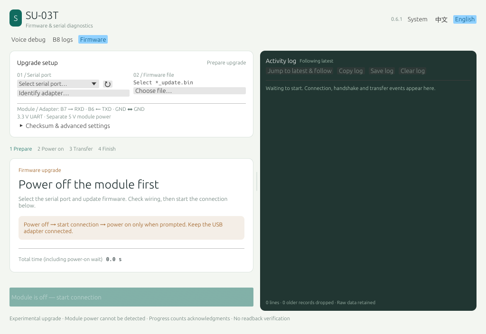
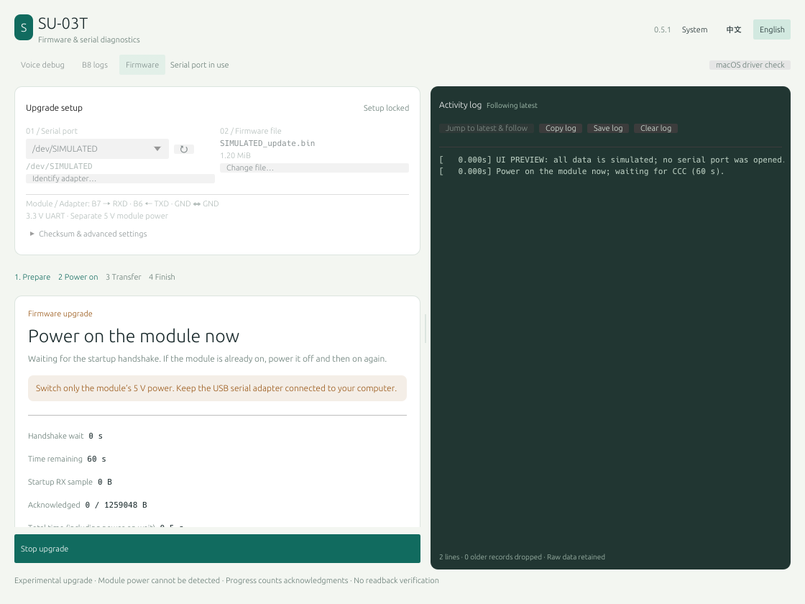

# SU-03T Tools

[简体中文](README.md) | English

A native **SU-03T / Hummingbird-M** firmware updater and serial diagnostic tool for macOS, Linux and Windows, built in Rust with a desktop UI and CLI.

[](https://github.com/MatriQ/su03t-tools/actions/workflows/check.yml) [](LICENSE)


*Firmware flashing has passed acceptance testing on physical SU-03T hardware. See the [validation record](.harness/docs/validation.md#hardware-acceptance).*

## Features

- **Firmware transfer:** file and SHA-256 checks, startup handshake, acknowledged progress, visible retries and final acknowledgment.
- **Power-cycle guidance:** explicit instructions to power off, wait for serial readiness, power on, keep power stable and restart after completion.
- **Persistent logs:** a full-height right pane with adjustable width and compact spacing. Scroll up to pause following, return to the bottom to resume; clear, copy or save the log.
- **Serial diagnostics:** passive monitoring, HEX / UTF-8 views, explicit manual transmission, raw RX export and rotating recordings.
- **Chinese and English UI:** follow the system language or remember a manual choice. Switching languages preserves the connection, progress and log reading position.

## Installation

### macOS: Homebrew (recommended)

Install on Apple Silicon or Intel Macs using the project's [Homebrew tap](https://github.com/MatriQ/homebrew-tap):

```bash
brew install --cask matriq/tap/su03t-tools
```

The app is installed in `/Applications/SU03T Update.app` by default, with a `su03t-update` command. Open it from Applications, or run `su03t-update` to start the desktop interface.

Quit the app before upgrading, then run:

```bash
brew update
brew upgrade --cask matriq/tap/su03t-tools
```

Uninstall with `brew uninstall --cask matriq/tap/su03t-tools`. See the [tap installation guide](https://github.com/MatriQ/homebrew-tap/blob/main/README.en.md) for a custom app directory and other options.

### Windows 10 / 11 x64

**Portable edition:** download the archive ending in `Windows-x86_64-portable.zip` from [Releases](https://github.com/MatriQ/su03t-tools/releases/latest), extract the complete folder into a writable location and open `su03t-tools.exe`. Use `su03t-update.exe` for the CLI. No installation or administrator privileges are required.

Keep `portable.flag` beside both executables. Language preferences are saved in the adjacent `data/language.json`. Quit before moving the entire folder; preferences move with it. To upgrade, replace the application files and retain `data`. Delete the folder to remove the portable edition. It does not write to `%APPDATA%` or create Start menu shortcuts. The UI reports a save error if the directory is not writable.

**User installation:** run the following command in PowerShell without administrator privileges. This uses the regular `Windows-x86_64.zip` and keeps language preferences in `%APPDATA%\SU03T Tools`:

```powershell
irm https://github.com/MatriQ/su03t-tools/releases/latest/download/install.ps1 | iex
```

The script verifies SHA-256, installs into `%LOCALAPPDATA%\Programs\SU03T Tools\app` by default, creates a Start menu shortcut and prints the full CLI path. Quit the app and run the same command to upgrade.

To uninstall while retaining language preferences:

```powershell
& ([scriptblock]::Create((irm https://github.com/MatriQ/su03t-tools/releases/latest/download/install.ps1))) -Uninstall
```

Use the `COM` number shown under Device Manager > Ports (COM & LPT), for example `COM3`. If no serial interface appears, follow the adapter vendor's Windows driver instructions. Windows board acceptance and software CI evidence are recorded separately in [validation](.harness/docs/validation.md).



### Install script: macOS / Linux

The script supports macOS (Apple Silicon / Intel) and Linux (x86_64 / ARM64). It selects the latest stable package and verifies SHA-256:

```bash
curl -fsSL https://github.com/MatriQ/su03t-tools/releases/latest/download/install.sh | bash
```

| System | Default installation | Launch |
| --- | --- | --- |
| macOS | `~/Applications/SU03T Update.app` | Open the app, or use the full command printed by the installer |
| Linux | `~/.local/share/su03t-tools/vX.Y.Z` | `~/.local/bin/su03t-update`; use `su03t-update` when the command directory is in PATH |

Run the script again to upgrade, after quitting the app. Choose one installation method and use it for updates; resolve existing app or command conflicts before switching methods.

Choose a version or destination:

```bash
curl -fsSL https://github.com/MatriQ/su03t-tools/releases/latest/download/install.sh | \
  bash -s -- --version v0.6.1 --prefix "$HOME/Applications"
```

On macOS, `--prefix` is the directory containing the app bundle. On Linux it is the installation root containing `bin/` and `share/`. You can also download and inspect [install.sh](https://github.com/MatriQ/su03t-tools/releases/latest/download/install.sh) before running it.

### Manual download

Download the macOS universal ZIP, your Linux architecture's `.tar.gz`, or the Windows x64 ZIP from [Releases](https://github.com/MatriQ/su03t-tools/releases/latest), and verify it with the `SHA256SUMS.txt` from the same release.

### Runtime requirements and first launch

The macOS deployment target is 12.0. The current app is ad-hoc signed and not notarized. Verify the download source, then follow macOS prompts to approve the first launch in System Settings > Privacy & Security.

The Windows package is unsigned; Windows may show an unknown-publisher prompt on first launch. Windows builds target x64 and the GUI needs an active desktop session.

Linux packages are built on Ubuntu 24.04 and need compatible glibc and runtime libraries; see [building from source](https://github.com/MatriQ/su03t-tools/blob/main/.harness/docs/development.md#building-from-source) for other environments. Debian / Ubuntu desktop runtime packages:

```bash
sudo apt-get install libudev1 libxkbcommon0 libxkbcommon-x11-0 libwayland-client0 \
  libx11-6 libxcursor1 libxi6 libxrandr2 libgl1 libegl1 fonts-noto-cjk
```

Chinese text requires an available CJK font. Linux serial permissions are managed by the OS; check dialout/uucp membership or device permissions. The app does not open ports using sudo. See [validation](.harness/docs/validation.md) for the tested OS, board and driver scope.

## macOS startup driver check

The app checks USB serial devices and their serial interfaces in the background at startup. The driver status entry is shared by upgrade and debug pages, and results are added to the activity log.

- **Drivers ready:** a serial interface exists. Both system and vendor drivers are recognized.
- **USB detected, serial interface missing:** the initial check opens guidance with the chip vendor's official driver link and extension approval instructions. Also check that the device is in serial mode.
- **No adapter detected:** connect the USB serial adapter and choose **Check again**; the module may remain powered off. Driver readiness is unverified until an adapter is detected.
- **Check failed:** inspect the error and retry, or continue using an existing port.


Common WCH CH34x / CH91xx, Silicon Labs CP210x and FTDI products are identified by USB product IDs. For a device with custom IDs and no serial interface, consult the board manufacturer. Identical adapters are checked separately; a USB hub cannot claim a downstream device's serial port as its own.

The check reads system device information without opening a serial port. Port usage and access permissions are checked when connecting. Module identity, power and actual high-baud transfer performance remain unverified. Driver resources: [WCH's official repository](https://github.com/WCHSoftGroup/ch34xser_macos), [Silicon Labs](https://www.silabs.com/software-and-tools/usb-to-uart-bridge-vcp-drivers), [FTDI](https://ftdichip.com/drivers/vcp-drivers/).

## Wiring and modes

**UART signals use 3.3 V levels. The module typically uses a separate 5 V supply. Do not confuse the two.** With independent module power, leave the adapter VCC disconnected and connect common ground. Switch only module power; keep the USB serial adapter connected to the computer. Check the actual board power requirements and firmware pin mapping.

| Mode | Default settings | Module / USB serial adapter |
| --- | --- | --- |
| Upgrade / startup probe | 921600 / 8N1 / no flow control | B7 → RXD, B6 ← TXD, GND ↔ GND |
| Serial diagnostics (custom mode) | 115200 / 8N1 / no flow control, configurable | Module TX → RXD, module RX ← TXD, GND ↔ GND; pins follow the firmware definition |
| B8 startup logs | 57600 / 8N1 / receive only | B8 → RXD, GND ↔ GND; TXD disconnected |

Match serial settings and pin mapping to the target firmware and adjust them in custom mode. The tool does not install drivers or control module reset through DTR/RTS.

## Upgrading firmware

1. Power off the module. Select its serial port and the manufacturer's `*_update.bin` file. Hover over the filename for its path; advanced settings show SHA-256.
2. Choose **Module is off — start connection**. The tool checks the file before opening the port.
3. When **Power on the module now** appears, connect module power. Keep the USB adapter connected.
4. Transfer begins after the startup handshake. Keep power stable and watch the wait, retry and acknowledgment events in the log.
5. Data progress reaching 100% still requires final device acknowledgment. After completion is confirmed, power-cycle the module and test its wake word and voice commands.



A compatible Hummingbird-M bootloader is required. Active mode repeats `32` hex (ASCII `2`) as the startup trigger; it can be disabled in advanced settings. No firmware is sent before `CCC`. A full `release.bin` image cannot directly replace the serial update file.

### When the first block is not acknowledged

The UI shows elapsed wait time, retry count and remaining time for the current attempt. Defaults are a 5-second response timeout and 30 retries. Repeated timeouts produce a visible warning. You can keep waiting, or stop before checking B6/B7 wiring, common ground, power and the serial connection.


**Clear log affects only the display.** It does not stop the transfer or reset progress, counters or failure context. Incoming logs do not interrupt reading history. Scroll to the bottom or choose **Jump to latest & follow** to resume following. Long lines can be scrolled horizontally.

The **Startup probe · No firmware** entry needs no image and is passive by default; startup triggering must be enabled explicitly. It sends no firmware, EOT, or guessed erase/reset commands.

## Serial monitoring and recording

Connections start passively. Transmission requires an explicit action and supports HEX or UTF-8. No framing or text terminator is automatically added. B8 mode blocks transmission in the communication core and is intended for startup logs.

- The debug display retains up to 2000 records / 1 MiB. The independent RX buffer retains up to 1 MiB. Clearing the display preserves session counters, raw RX and recorded files.
- Copy/save exports the retained display records. RX BIN export saves retained raw bytes. Device output, HEX, paths, filenames and checksums remain unchanged when switching languages.
- Continuous recording creates `.rx.bin` and `.log` streams, each retaining up to four rotating 16 MiB files. A new connection creates new files rather than overwriting other sessions.
- TX counts host writes, not device acknowledgments. Serial read chunks are not protocol frames.

## CLI

Running without arguments opens the desktop app. These commands use the same communication core:

```bash
su03t-update ports
su03t-update firmware-info --firmware firmware_update.bin
su03t-update monitor --port /dev/ttyUSB0 --profile custom --baud 115200
su03t-update monitor --port /dev/ttyUSB0 --profile b8 --duration 60 --record ./session-001
su03t-update probe --port /dev/ttyUSB0 --baud 921600 --wait 15
su03t-update flash --port /dev/ttyUSB0 --firmware firmware_update.bin
```

On Windows, use `.\su03t-update.exe` from the extracted directory and the actual `COM` number, or use the full CLI path printed by the installer. On macOS, use the enumerated `/dev/cu.*` path. `probe` listens passively unless `--trigger` is supplied. `monitor` transmits only with explicit `--send-hex` or `--send-text` arguments. See `--help` for additional options. Desktop language selection does not change the existing CLI output format.

## Compatibility

Firmware upgrading remains experimental and is not assumed compatible with other module models. `CCC` does not identify a model. EOT ACK confirms the end of transfer only: **it does not verify flash readback, normal boot or voice functions.** Use firmware and a bootloader known to match your module. See the [protocol](.harness/docs/protocol.md) and [validation record](.harness/docs/validation.md).

## Development and Harness

The repository's Harness keeps shared development, verification and release guidance in `.harness/docs/` for maintainers, Codex and Claude Code. [AGENTS.md](https://github.com/MatriQ/su03t-tools/blob/main/AGENTS.md) is the canonical entry; `CLAUDE.md` links to it.

- [Building from source and local development](https://github.com/MatriQ/su03t-tools/blob/main/.harness/docs/development.md#building-from-source)
- [Testing and verification](https://github.com/MatriQ/su03t-tools/blob/main/.harness/docs/testing.md)
- [Packaging and automated releases](https://github.com/MatriQ/su03t-tools/blob/main/.harness/docs/release.md)
- [Harness guide](https://github.com/MatriQ/su03t-tools/blob/main/.harness/docs/index.md) and [maintenance](https://github.com/MatriQ/su03t-tools/blob/main/.harness/docs/maintenance.md)

Read the [contribution guide](https://github.com/MatriQ/su03t-tools/blob/main/CONTRIBUTING.md) before contributing.

## License and references

Original code is provided under the [MIT License](LICENSE). Vendor firmware, vendor flashing tools and drivers are not included. Third-party dependencies and optional vendor materials retain their own licenses. This is an independent project, not an official vendor client.

[SU-03T documentation](https://docs.aimachip.com/zh-cn/latest/file/offlineVoice/SU03T.html) · [Hummingbird-M FAQ](https://doc.hivoice.cn/udp/%E5%B8%B8%E8%A7%81%E9%97%AE%E9%A2%98.html)
