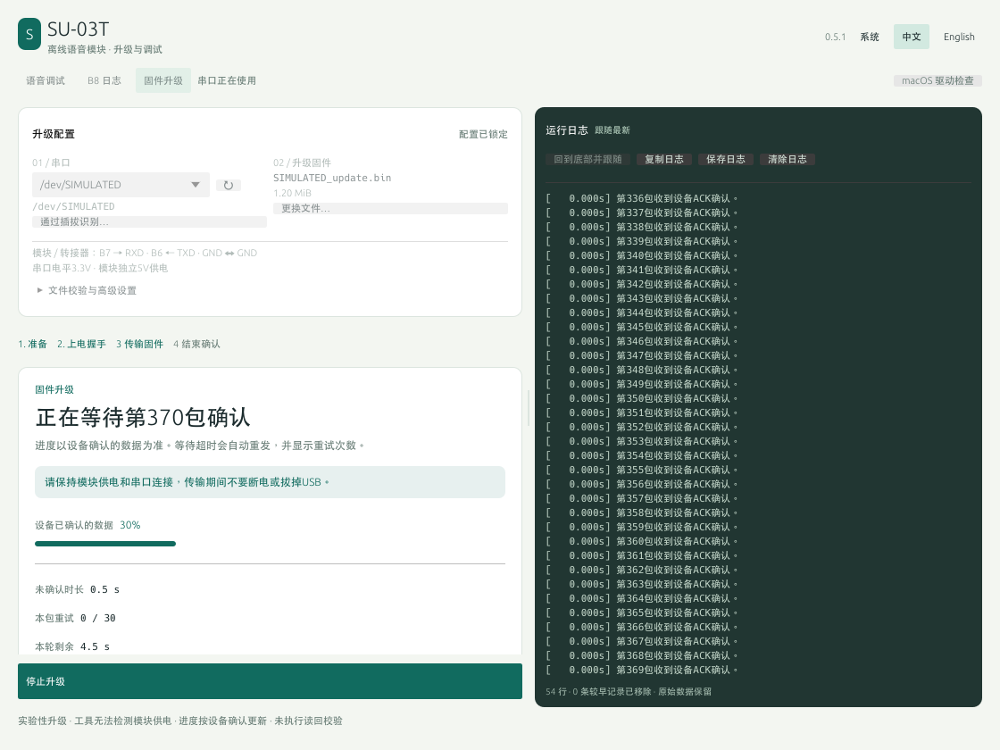
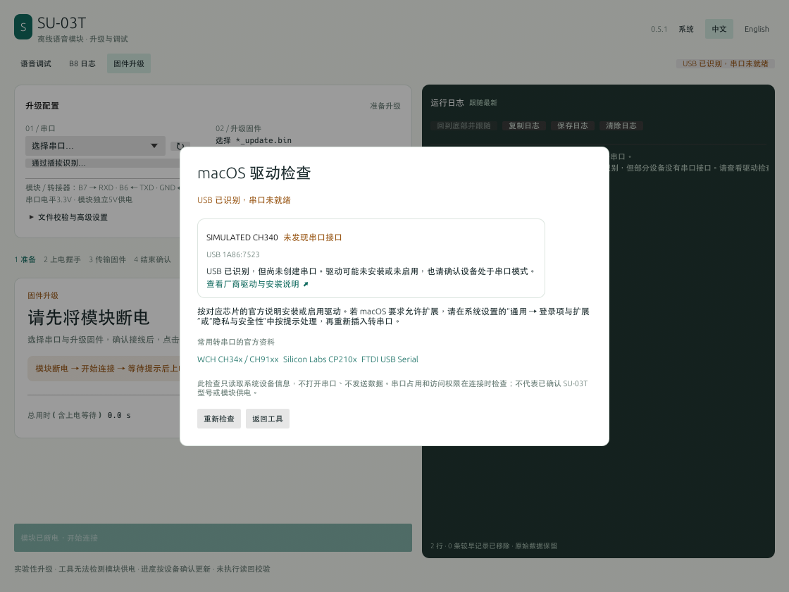
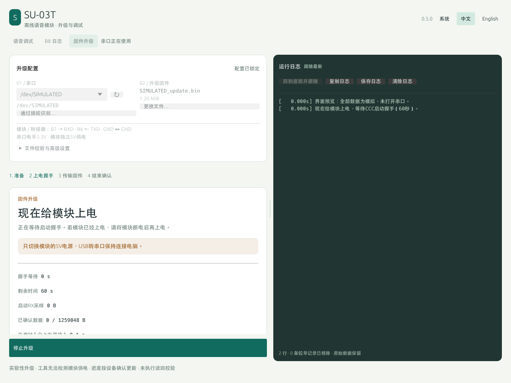
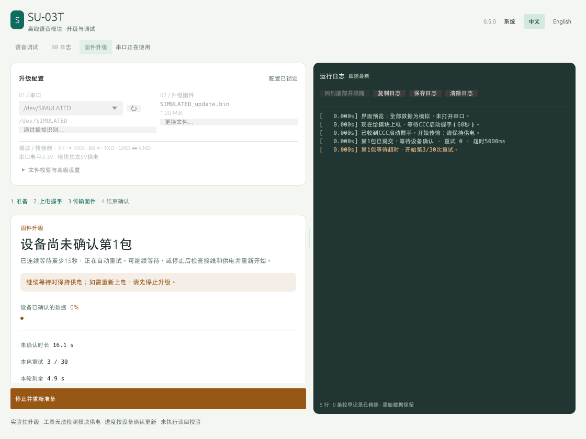

# SU-03T Tools

简体中文 | [English](README.en.md)

面向 **SU-03T / 蜂鸟 M** 的串口固件升级与调试工具，使用 Rust 构建原生桌面界面和 CLI，支持 macOS、Linux 和 Windows。

[](https://github.com/MatriQ/su03t-tools/actions/workflows/check.yml) [](LICENSE)



*已通过 SU-03T 实机刷机验收，详见[验证记录](.harness/docs/validation.md#hardware-acceptance)。*

## 功能

- **固件升级**：文件与 SHA-256 检查、启动握手、按设备 ACK 推进的进度、超时重试和结束确认。
- **上下电引导**：明确区分“先断电”“串口就绪后上电”“保持供电”“完成后重新上电验证”。
- **常驻日志**：右侧通高面板、可拖动宽度、紧凑行距；上翻暂停跟随，到底部自动恢复；支持清除、复制和保存。
- **串口调试**：被动监听、HEX / UTF-8 显示、显式手动发送、接收 BIN 导出和滚动记录。
- **中英界面**：中文 / English / 系统语言，记住选择；切换不重置连接、进度或日志阅读位置。

## 安装

### macOS：Homebrew（推荐）

适用于 Apple Silicon 和 Intel Mac，通过项目维护的 [Homebrew tap](https://github.com/MatriQ/homebrew-tap) 安装：

```bash
brew install --cask matriq/tap/su03t-tools
```

应用默认安装到 `/Applications/SU03T Update.app`，同时提供 `su03t-update` 命令。安装后可从“应用程序”打开，或运行 `su03t-update` 启动桌面界面。

更新前先退出应用，然后执行：

```bash
brew update
brew upgrade --cask matriq/tap/su03t-tools
```

卸载使用 `brew uninstall --cask matriq/tap/su03t-tools`。自定义应用目录等用法见 [tap 安装说明](https://github.com/MatriQ/homebrew-tap/blob/main/README.md)。

### Windows 10 / 11 x64

从 [Releases](https://github.com/MatriQ/su03t-tools/releases/latest) 下载 `Windows-x86_64.zip`，完整解压后双击 `su03t-tools.exe` 打开桌面界面；`su03t-update.exe` 用于命令行。两个程序请放在同一目录。

也可在 PowerShell 中一键安装到当前用户目录，无需管理员权限：

```powershell
irm https://github.com/MatriQ/su03t-tools/releases/latest/download/install.ps1 | iex
```

脚本校验 SHA-256，默认安装到 `%LOCALAPPDATA%\Programs\SU03T Tools\app` 并创建开始菜单快捷方式，同时输出 CLI 完整路径。更新前退出应用，再运行同一命令。

卸载时运行以下命令，保留语言设置：

```powershell
& ([scriptblock]::Create((irm https://github.com/MatriQ/su03t-tools/releases/latest/download/install.ps1))) -Uninstall
```

串口使用设备管理器“端口（COM 和 LPT）”中显示的 `COM` 号，例如 `COM3`。未创建串口接口时，请按转接芯片厂商说明安装 Windows 驱动。Windows 实板刷机验收与软件 CI 验证分别记录在[验证范围](.harness/docs/validation.md)。

### 安装脚本：macOS / Linux

脚本支持 macOS（Apple Silicon / Intel）和 Linux（x86_64 / ARM64），自动选择最新稳定包并校验 SHA-256：

```bash
curl -fsSL https://github.com/MatriQ/su03t-tools/releases/latest/download/install.sh | bash
```

| 系统 | 默认安装位置 | 启动方式 |
| --- | --- | --- |
| macOS | `~/Applications/SU03T Update.app` | 打开应用，或使用安装器显示的完整命令 |
| Linux | `~/.local/share/su03t-tools/vX.Y.Z` | `~/.local/bin/su03t-update`；命令目录在 PATH 中时可直接运行 `su03t-update` |

更新时重新运行脚本；原有运行中的应用请先退出。请选择一种安装方式并使用同一方式更新，更换方式前处理已有应用或同名命令冲突。

指定版本或安装目录：

```bash
curl -fsSL https://github.com/MatriQ/su03t-tools/releases/latest/download/install.sh | \
  bash -s -- --version v0.5.4 --prefix "$HOME/Applications"
```

`--prefix` 在 macOS 指放置 `.app` 的目录；在 Linux 指包含 `bin/` 和 `share/` 的安装根目录。也可下载 [install.sh](https://github.com/MatriQ/su03t-tools/releases/latest/download/install.sh) 阅读后执行。

### 手动下载

从 [Releases](https://github.com/MatriQ/su03t-tools/releases/latest) 下载 macOS 通用 ZIP，对应架构的 Linux `.tar.gz`，或 Windows x64 ZIP，并用同一 Release 中的 `SHA256SUMS.txt` 校验。

### 运行要求与首次打开

macOS 应用的构建目标为 12.0，当前使用临时签名、未公证。首次打开请确认下载来源，并按系统提示在“系统设置 → 隐私与安全性”中允许打开。

Windows 安装包未签名，首次打开可能显示发布者未知的系统提示。Windows 提供 x64 版本，使用图形界面需要桌面会话。

Linux 发行包在 Ubuntu 24.04 上构建，需要兼容的 glibc 和运行库；其他环境见[源码构建说明](https://github.com/MatriQ/su03t-tools/blob/main/.harness/docs/development.md#building-from-source)。Debian / Ubuntu 桌面运行库示例：

```bash
sudo apt-get install libudev1 libxkbcommon0 libxkbcommon-x11-0 libwayland-client0 \
  libx11-6 libxcursor1 libxi6 libxrandr2 libgl1 libegl1 fonts-noto-cjk
```

中文显示需要可用的中文字体。Linux 串口权限由系统配置决定；检查 dialout/uucp 组或设备权限，工具不会使用 sudo 打开串口。具体系统、板型和驱动兼容性见[验证范围](.harness/docs/validation.md)。

## macOS 启动驱动检查

打开应用后，会在后台检查 USB 转串口与串口接口的关联。顶部的驱动状态入口同时用于升级和调试页面，检测结果也会写入日志。

- **驱动已就绪**：设备已创建串口接口，识别系统自带驱动和厂商驱动。
- **USB 已识别，串口未就绪**：首次检测时自动打开说明，提供对应芯片的官方驱动链接和启用扩展的指引；同时检查设备是否处于串口模式。
- **未检测到转串口**：先连接 USB 转串口，模块可以保持断电，再点“重新检查”。此时驱动状态尚未验证。
- **检查失败**：显示错误并支持重试，仍可使用已有串口。



常见 WCH CH34x / CH91xx、Silicon Labs CP210x 和 FTDI 设备按 USB 产品 ID 识别。有自定义 USB ID 的设备，若未创建串口，请查阅板卡厂商说明。同型号多设备分别判断，USB 集线器不会借用下游设备的串口作为就绪证据。

检查以只读方式查询系统设备信息，不打开串口。串口占用和访问权限在连接时确认；该检查不验证模块型号、供电或高波特率下的实际传输能力。驱动说明来自 [WCH 官方仓库](https://github.com/WCHSoftGroup/ch34xser_macos)、[Silicon Labs](https://www.silabs.com/software-and-tools/usb-to-uart-bridge-vcp-drivers) 和 [FTDI](https://ftdichip.com/drivers/vcp-drivers/)。

## 接线与模式

**串口信号是 3.3V 电平，模块通常独立使用 5V 供电。两者不要混淆。** 独立供电时转接器 VCC 不接，必须共地；只切换模块电源，USB 转串口保持连接电脑。具体电源能力和引脚映射以开发板与固件为准。

| 模式 | 默认参数 | 模块与 USB 转串口接线 |
| --- | --- | --- |
| 固件升级 / 启动诊断 | 921600 / 8N1 / 无流控 | B7 → RXD、B6 ← TXD、GND ↔ GND |
| 串口调试（通用模式） | 115200 / 8N1 / 无流控，可调整 | 模块 TX → RXD、模块 RX ← TXD、GND ↔ GND；引脚按固件定义 |
| B8 启动日志 | 57600 / 8N1 / 只接收 | B8 → RXD、GND ↔ GND，TXD 不接 |

串口参数和引脚映射应以目标固件定义为准，可在通用模式中调整。工具不自动安装驱动，也不通过 DTR/RTS 控制模块复位。

## 固件升级

1. 先将模块断电，选择实际串口和平台导出的 `*_update.bin`。悬停文件名可查看路径，高级设置中可查看 SHA-256。
2. 点击 **模块已断电，开始连接**。工具先检查文件，再打开串口。
3. 出现 **现在给模块上电** 后，接通模块电源。USB 转串口保持连接。
4. 收到启动握手后自动传输。保持供电，观察右侧日志中的等待、重试和确认。
5. 全部数据达到 100% 后仍需等待设备结束确认。收到完成提示后，将模块断电再上电，验证唤醒词及语音指令。



升级需要兼容的蜂鸟 M 启动程序。默认重复发送 `32`（ASCII 字符 `2`）作为启动触发；高级设置可关闭。未收到 `CCC` 前不传固件。`release.bin` 完整镜像不能直接替代串口升级文件。

### 停在首包确认时

界面会显示等待时长、当前重试次数及本轮剩余时间。默认每次等待 5 秒，最多重试 30 次；连续超时后给出明显提示，可继续等待，或先停止，再检查 B6/B7、共地、供电和串口连接后重试。



**清除日志只清空显示**，不停止烧录，也不重置进度、计数或故障上下文。上翻查看历史时，新日志不会抢走阅读位置；滚动到底部或点击“回到底部并跟随”可恢复跟随。长行可横向滚动。

“启动诊断 · 不传固件”无需选择文件，默认只接收；可显式启用启动触发。它不会发送固件、EOT 或猜测的擦除、复位命令。

## 串口调试与记录

连接后默认只监听。发送必须手动触发，支持 HEX 和 UTF-8；不自动添加帧头、帧尾或文本结尾。B8 模式在通信核心禁止发送，适合观察上电日志。

- 调试显示缓冲最多 2000 条 / 1 MiB，独立 RX 缓冲最多 1 MiB。清除显示保留会话计数、RX 缓冲及记录文件。
- 复制 / 保存导出当前显示记录；接收 BIN 导出保留的原始字节。设备输出、HEX、路径、文件名和校验值不随语言切换改写。
- 连续记录创建 `.rx.bin` 和 `.log`。每流最多四个 16 MiB 文件，超限滚动，新连接创建新文件，不覆盖其他会话。
- TX 计数表示主机写入，不表示模块已确认；串口读取分块不等于协议帧。

## CLI

无参数打开 GUI，以下命令使用同一个通信核心：

```bash
su03t-update ports
su03t-update firmware-info --firmware firmware_update.bin
su03t-update monitor --port /dev/ttyUSB0 --profile custom --baud 115200
su03t-update monitor --port /dev/ttyUSB0 --profile b8 --duration 60 --record ./session-001
su03t-update probe --port /dev/ttyUSB0 --baud 921600 --wait 15
su03t-update flash --port /dev/ttyUSB0 --firmware firmware_update.bin
```

Windows 在解压目录使用 `.\su03t-update.exe`，串口名使用实际 `COM` 号；PowerShell 安装后可使用安装器显示的 CLI 完整路径。macOS 使用实际枚举的 `/dev/cu.*`。`probe` 默认被动监听，需要启动触发时显式加 `--trigger`。`monitor` 仅在显式指定 `--send-hex` 或 `--send-text` 时发送。更多参数见 `--help`。

## 兼容范围

串口升级仍是实验性功能，不能默认用于其他型号。`CCC` 不识别型号，EOT ACK 只确认传输结束，**不等于读回校验、正常启动或语音功能验证**。请始终使用已确认适配的固件和启动程序。参见[协议说明](.harness/docs/protocol.md)和[验证记录](.harness/docs/validation.md)。

## 开发与 Harness

本仓库的 Harness 将开发、验证与发布指引集中维护在 `.harness/docs/`，供维护者、Codex 和 Claude Code 共用。统一入口是 [AGENTS.md](https://github.com/MatriQ/su03t-tools/blob/main/AGENTS.md)，`CLAUDE.md` 指向同一入口。

- [从源码构建与本地开发](https://github.com/MatriQ/su03t-tools/blob/main/.harness/docs/development.md#building-from-source)
- [测试与验证](https://github.com/MatriQ/su03t-tools/blob/main/.harness/docs/testing.md)
- [打包与自动发布](https://github.com/MatriQ/su03t-tools/blob/main/.harness/docs/release.md)
- [Harness 导航](https://github.com/MatriQ/su03t-tools/blob/main/.harness/docs/index.md)与[维护说明](https://github.com/MatriQ/su03t-tools/blob/main/.harness/docs/maintenance.md)

参与开发前，请阅读[贡献指南](https://github.com/MatriQ/su03t-tools/blob/main/CONTRIBUTING.md)。

## 许可证与资料

原创代码使用 [MIT License](LICENSE)。仓库不包含厂商固件、厂商烧录工具或驱动；第三方依赖和可选厂商资料保留各自许可证。本项目不是厂商官方客户端。

[SU-03T 模组资料](https://docs.aimachip.com/zh-cn/latest/file/offlineVoice/SU03T.html) · [蜂鸟 M FAQ](https://doc.hivoice.cn/udp/%E5%B8%B8%E8%A7%81%E9%97%AE%E9%A2%98.html)
